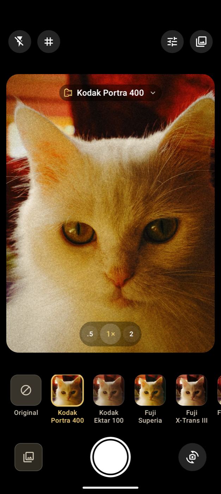

<p align="center">
  
</p>

<h1 align="center">camera4u</h1>

<p align="center">
  A Pixel 8a camera with cinematic looks, skin-aware grading, cinema framing and real manual controls.
  Fork of <a href="https://github.com/YahiaAngelo/FilmCamera-Android">Film Camera for Android</a> (MIT).
</p>

<p align="center">
  
</p>

This is the Android port of [Film Camera for iOS](https://github.com/YahiaAngelo/Film-Camera). It's written in Kotlin with Jetpack Compose, Material 3 and CameraX.

## Features

- **Live film preview.** Every camera frame runs through a GPU pipeline: exposure and white balance, the film's 3D LUT, then tone, color and film effects. Full-resolution photos go through the same shaders, so the saved photo matches the viewfinder.
- **Around 300 film stocks** from the [Film-Luts](https://github.com/YahiaAngelo/Film-Luts) collection: color negative, slide, black & white, instant, cinema print and Fuji X-Trans simulations. Browse and search them, download one or all of them for offline use, and reorder the ones you use in your film strip.
- **Works offline from the first launch.** Eight popular stocks are built in, along with the full catalog.
- **Film effects:** two-octave grain re-seeded every frame, glow, halation, vignette and fade.
- **Adjustments:** exposure, contrast, highlights, shadows, saturation, warmth, tint and film strength. They're in a standard bottom sheet that keeps the viewfinder visible and live.
- **Camera controls:** lens buttons (ultra wide, 1×, telephoto or a 2× crop), pinch to zoom, tap to focus and expose, flash, grid, front camera, and the volume keys as a shutter.
- **Material 3 design** with the warm film palette shared with the iOS app.

## Requirements

- Android Studio with AGP 9.4 or later
- A device running Android 10 (API 29) or later with OpenGL ES 3.0

## Getting started

Open the project in Android Studio and run the **app** configuration, or from the command line:

```sh
./gradlew :app:installDebug
```

The emulator's virtual scene camera works, so you can develop the UI and the look without a device. Debug builds can also feed a still sample scene through the pipeline instead of the camera:

```sh
adb shell am start -n it.bosiux.camera4u/.MainActivity --ez sampleScene true
```

The sample image lives in `src/debug`, so it's left out of release builds. [docs/PLAY_STORE.md](docs/PLAY_STORE.md) lists the other launch extras used for screenshots.

Run the unit tests with:

```sh
./gradlew :app:testDebugUnitTest
```

## Releasing

Release builds are minified with R8 and signed with the Google Play upload key. Signing reads `keystore.properties` in the project root, which is git-ignored:

```properties
storeFile=/absolute/path/to/upload.jks
storePassword=…
keyAlias=upload
keyPassword=…
```

On CI, set `FILM_CAMERA_KEYSTORE`, `FILM_CAMERA_KEYSTORE_PASSWORD`, `FILM_CAMERA_KEY_ALIAS` and `FILM_CAMERA_KEY_PASSWORD` instead. Without either, release builds are unsigned.

```sh
./gradlew :app:bundleRelease
```

The listing text, store graphics, Data safety answers and a submission checklist are in [docs/PLAY_STORE.md](docs/PLAY_STORE.md).

## How it works

```
app/src/main/java/io/github/yahiaangelo/filmcamera/
├── rendering/   GLSL shaders, FilmRenderer, the EGL thread and the .cube LUT parser
├── camera/      CameraX binding, photo capture and saving
├── library/     Film catalog, downloads and offline storage
├── model/       Film and adjustment models
└── ui/          Compose screens (camera, film library, adjustments)
```

The pipeline in [`FilmShaders.kt`](app/src/main/java/io/github/yahiaangelo/filmcamera/rendering/FilmShaders.kt) is a port of the iOS Metal shaders:

1. **grade:** exposure and white balance in linear light, then trilinear sampling of the film's 3D LUT texture, then highlights/shadows, contrast, saturation and fade.
2. **bright** and **blur:** quarter-resolution highlight extraction, then a separable Gaussian blur for glow and halation.
3. **composite:** glow, halation, vignette and grain, plus an aspect-fill crop for the preview.

CameraX delivers preview frames into a `SurfaceTexture`. The grade pass samples that external OES texture directly, so frames never pass through the CPU. `FilmGlThread` owns the EGL context and draws into the viewfinder's `TextureView`. Photos are captured with `ImageCapture` at up to 12 MP, uploaded as a texture and rendered offscreen through the same programs. They're saved as JPEG to Pictures/Film Camera, with the original EXIF data kept.

LUTs are standard `.cube` files. The catalog and LUTs are downloaded from the Film-Luts repository and stored in app storage. Thumbnails are cached by Coil.

## Credits

- Film LUTs: [Film-Luts](https://github.com/YahiaAngelo/Film-Luts), a collection of [G'MIC](https://gmic.eu) film emulation LUTs. See that repository for its disclaimer and terms.
- Color palette: shared with [Film Simulator](https://github.com/YahiaAngelo/Film-Simulator).

Film stock names are trademarks of their respective owners. They are used only to describe the look each LUT emulates. This project is not affiliated with or endorsed by Kodak, Fujifilm, Ilford, Polaroid or any other manufacturer.

## Privacy

Film Camera collects no data. See [PRIVACY.md](PRIVACY.md).

## License

[MIT](LICENSE)
